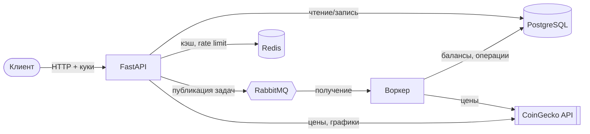

# fastapi_cryptowallets

Бэкенд кастодиального криптокошелька на **FastAPI**. Пользователь регистрируется, получает кошелёк в формате Ethereum, пополняет баланс, переводит средства другим пользователям или на внешние адреса и отслеживает прибыль и убыток по своему портфелю на основе актуальных рыночных данных **CoinGecko**.

Тяжёлые операции (создание кошелька, пополнение, переводы, вывод) выполняются **асинхронно** фоновым воркером через **RabbitMQ**: API сразу отвечает `202 Accepted`, а клиент опрашивает статус операции.

## Что демонстрирует проект

- **Асинхронный Python от начала до конца**: FastAPI, SQLAlchemy 2.0 (async), asyncpg, httpx, aio-pika, redis-py (asyncio).
- **Аутентификация и авторизация**: JWT access/refresh токены в `HttpOnly`-куках, хеширование паролей bcrypt, ролевая модель (`user` / `admin`), блокировка аккаунтов с указанием причины.
- **Событийная архитектура**: API публикует задачи в RabbitMQ, отдельный воркер их обрабатывает, состояние операций хранится в PostgreSQL.
- **Redis** для кэширования ответов (со своим TTL для каждого эндпоинта) и **rate limiter** со скользящим окном на отсортированных множествах (middleware + зависимость).
- **Работа с секретами**: приватные ключи кошельков шифруются Fernet до попадания в базу, конфигурация берётся из переменных окружения.
- **Аккуратная работа с деньгами**: арифметика на `Decimal`, колонки `Numeric(36,18)`, средневзвешенная цена покупки, комиссии (gas) для каждой валюты.
- **Интеграция со сторонним API** с обработкой ошибок (404/429 от внешнего сервиса пробрасываются, сетевые сбои превращаются в `503`).
- **Docker**: multi-stage образ, запуск от непривилегированного пользователя, стек `docker compose` с health checks.
- **Тестирование**: 300+ тестов (pytest, pytest-asyncio), для которых не нужны внешние сервисы.

## Архитектура



Как работает асинхронная операция:

1. `POST /wallets/send` проверяет запрос, сохраняет операцию (статус `pending`) и публикует сообщение в очередь `wallet.send`. Ответ: `202` и `operation_id`.
2. Воркер получает сообщение, выполняет перевод в транзакции базы данных и помечает операцию как `completed` (или `failed` с текстом ошибки).
3. Клиент опрашивает `GET /wallets/operations/{operation_id}`.

Очереди: `wallet.create`, `wallet.deposit`, `wallet.send`, `wallet.cancel`, `wallet.withdraw`.

## Возможности

**Пользователи и аутентификация**
- Регистрация, вход, выход, обновление токенов, изменение профиля, смена пароля
- Первый зарегистрированный пользователь становится администратором

**Администратор**
- Список пользователей (фильтры по роли и блокировке, пагинация), просмотр пользователя
- Блокировка и разблокировка с указанием причины, изменение данных пользователя, выдача роли администратора
- Заблокированный пользователь не может пользоваться сервисом, кроме **вывода** своих средств

**Кошельки**
- Создание кошелька (адрес Ethereum, зашифрованный приватный ключ)
- Пополнение: цена покупки фиксируется по данным CoinGecko для расчёта средней цены
- Перевод другому пользователю (внутренний) или на внешний адрес, с комиссией для каждой валюты
- Вывод средств, отмена ожидающей транзакции, балансы, история транзакций и статус операций
- 41 поддерживаемая монета (соответствие тикера и id в CoinGecko, например `BTC` → `bitcoin`)

**Рыночные данные (CoinGecko)**
- Топ монет по капитализации, данные по монете, трендовые монеты
- График цены в формате PNG (matplotlib)
- Прибыль и убыток по портфелю: по всем монетам или по одной

## Технологии

| Область | Инструменты |
|---|---|
| API | FastAPI, Uvicorn, Pydantic v2, pydantic-settings |
| База данных | PostgreSQL, SQLAlchemy 2.0 (async), asyncpg |
| Очереди | RabbitMQ, aio-pika |
| Кэш / rate limit | Redis |
| Безопасность | python-jose (JWT), bcrypt, cryptography (Fernet), eth-account |
| Внешний API | httpx → CoinGecko |
| Графики | matplotlib |
| Тесты | pytest, pytest-asyncio, pytest-cov, aiosqlite |
| DevOps | Docker, Docker Compose|

## Быстрый старт (Docker)

```bash
git clone https://github.com/Sipall81/fastapi_cryptowallet.git
cd fastapi_cryptowallet

cp .env.example .env
# отредактируйте .env: укажите ключ CoinGecko и сгенерируйте секреты (команды есть внутри файла)

docker compose up --build
```

API доступен на <http://localhost:8000>, интерактивная документация на <http://localhost:8000/docs>.

> Для локальной разработки по `http://` оставьте в `.env` значение `COOKIE_SECURE=false`: при `true` браузер не отправит куки авторизации по обычному HTTP.

### Попробовать через curl

```bash
# 1. Регистрация и вход (токены сохраняются в cookies.txt)
curl -X POST "http://localhost:8000/users/register?email=me@example.com&password=password123&name=Me"
curl -X POST -c cookies.txt "http://localhost:8000/users/login?email=me@example.com&password=password123"

# 2. Создание кошелька (асинхронно: возвращается id операции)
curl -X POST -b cookies.txt http://localhost:8000/wallets/create
curl -b cookies.txt http://localhost:8000/wallets/operations/<operation_id>

# 3. Пополнение на 0.5 BTC, балансы и прибыль/убыток по портфелю
curl -X POST -b cookies.txt "http://localhost:8000/wallets/deposit?currency=BTC&amount=0.5"
curl -b cookies.txt http://localhost:8000/wallets/ballances
curl -b cookies.txt http://localhost:8000/crypto/my_all_coins_changes
```

## Обзор API

| Группа | Эндпоинты |
|---|---|
| `/users` | `POST /register`, `POST /login`, `POST /logout`, `POST /refresh`, `GET /me`, `PATCH /update_data`, `POST /me/change_password`, `GET /user/{id}`, `GET /all_users` |
| `/admin` | `GET /users`, `GET /user/{id}`, `PATCH /change_user_data/{id}`, `POST /give_admin`, `DELETE /users/{id}/block`, `POST /users/{id}/unblock` |
| `/wallets` | `POST /create`, `POST /deposit`, `POST /send`, `POST /withdraw`, `POST /cancel_transaction`, `GET /operations`, `GET /operations/{id}`, `GET /transactions`, `GET /my_wallet`, `GET /ballances` |
| `/crypto` | `GET /top_coins`, `GET /coin/{coin_id}`, `GET /coin/chart`, `GET /trending`, `GET /my_all_coins_changes`, `GET /see_coin_changes/{coin_id}` |

Полные схемы запросов и ответов смотрите в Swagger UI (`/docs`).

## Запуск без Docker

Нужны Python 3.12+, PostgreSQL, Redis и RabbitMQ.

```bash
python -m venv .venv
source .venv/bin/activate          # Windows: .venv\Scripts\activate
pip install -r requirements.txt

cp .env.example .env               # укажите в DATABASE_URL / REDIS_URL / RABBITMQ_URL свои сервисы

uvicorn main:app --reload          # API
python -m workers.worker           # воркер (во втором терминале)
```

## Тесты

Тесты используют SQLite в памяти и подменяют Redis, RabbitMQ и CoinGecko моками, поэтому **внешние сервисы и файл `.env` не нужны**.

```bash
pip install -r requirements.txt -r requirements-dev.txt
pytest                             # запустить всё
pytest --cov                       # с покрытием (настройки в .coveragerc)
```

Покрыто: аутентификация и проверка токенов, пользователи, админка, API кошельков, сервис кошельков (балансы, комиссии, отмены), обработчики воркера, клиент RabbitMQ, rate limiter, эндпоинты CoinGecko, модели и константы.

## Структура проекта

```
.
├── main.py                 # приложение FastAPI, middleware, роутеры
├── config.py               # настройки из окружения (pydantic-settings)
├── database.py             # модели SQLAlchemy, движок, lifespan приложения
├── models.py               # Pydantic-схемы запросов и ответов
├── constants.py            # поддерживаемые монеты, комиссии
├── middleware.py           # middleware ограничения частоты запросов
├── rate_limiter.py         # лимитер на Redis со скользящим окном
├── redis_client.py         # подключение к Redis
├── rabbitmq_client.py      # публикация сообщений в RabbitMQ
├── auth/                   # JWT, хеширование паролей, зависимости FastAPI
├── routers/                # users, admin, wallets, coingecko
├── services/wallet_service.py   # логика кошельков, балансов и переводов
├── workers/worker.py       # обработчики очередей RabbitMQ
├── tests/                  # набор тестов pytest
├── Dockerfile
└── docker-compose.yml
```

## Ограничения

- **Блокчейн симулируется.** Адреса и приватные ключи настоящие, в формате Ethereum, но перевод это запись в базе данных, а его `tx_hash` генерируется локально. Взаимодействия с реальной сетью нет.
- Пополнение зачисляет средства напрямую по текущей цене CoinGecko (платёжного провайдера нет).
- Таблицы базы данных создаются при запуске приложения, миграций пока нет.


## Автор

[Sipall81](https://github.com/Sipall81)
